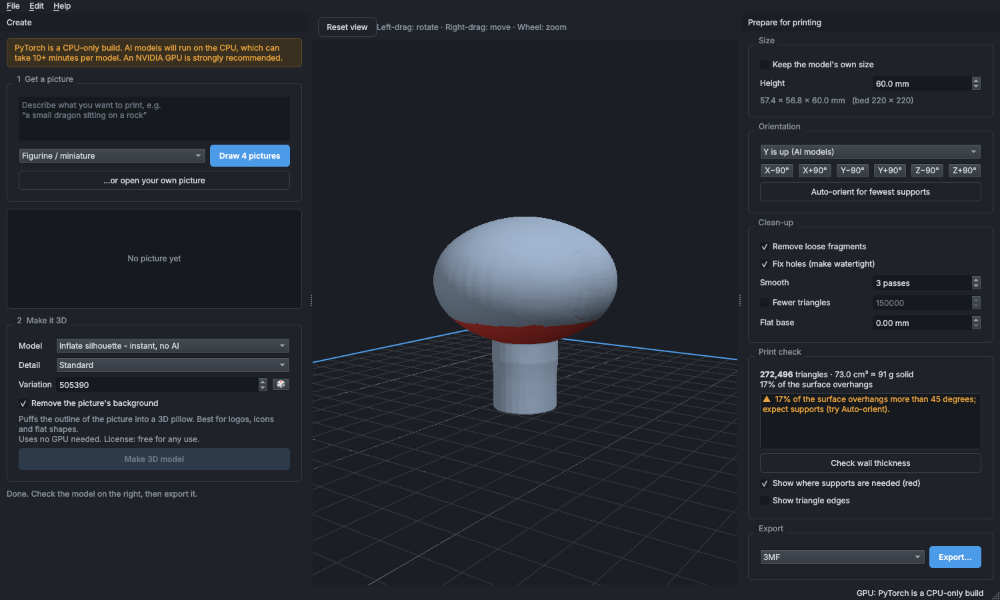

# Forge3D

A **local, subscription-free desktop app** that turns a text description or a picture into a 3D model that is
ready to print. It runs entirely on your own computer with open AI models: no account, no credits, no cloud.

Think of it as a self-hosted alternative to online "text/image to 3D" services, built around **3D printing** rather
than games: the output is a clean, watertight, correctly sized mesh with the printability checks a slicer would
otherwise make you discover the hard way.

```
describe it ──► 4 candidate pictures ──► pick one ──► 3D shape ──► repair + size + orient ──► STL / 3MF
```



*A real result: a mushroom generated by Hunyuan3D-2 Mini Turbo (here on a CPU-only test machine), repaired and sized
to 60 mm by the print tools. The red band under the cap marks the overhang that would need supports.*

## What you get

- **Text → 3D** in two visible steps (draw four reference pictures, pick the best, lift it to 3D), the same way the
  commercial services work internally. You choose the picture, so a bad draw costs seconds, not minutes.
- **Picture → 3D** from any photo, render or drawing. Background removal is automatic.
- **Print preparation built in**
  - removes loose floating fragments, fills holes, makes the mesh watertight, fixes inside-out faces
  - scales to a real size in millimetres, drops the model onto the bed
  - **auto-orient** to the pose that needs the fewest supports; one-click rotations
  - **overhang overlay**: red = needs supports; magenta = inside-out/open surface
  - flat-base cut, smoothing (no shrinkage), triangle reduction
  - print check: watertight, fits your bed, loose pieces, thin walls, material volume and weight
- **Export** STL, 3MF (millimetres stored in the file), OBJ, PLY, GLB.
- **Open any existing STL/OBJ/GLB/3MF/PLY** to repair and check it. It is useful even without AI.
- Also a **command line** (`forge3d gen ...`) for scripting and batch jobs.

## Requirements

| | |
|---|---|
| OS | Windows 10/11 (developed and tested on Linux; the code is cross-platform) |
| GPU | NVIDIA with **8 GB+ VRAM** recommended (an RTX 3070 is fine). Without a GPU the AI models run on the CPU: about 3.5 minutes per model for the smallest one at Draft detail in our test, and much slower for the larger ones. |
| Disk | about 5 GB for the default model, about 7 GB more for text-to-image |
| Python | 3.10 – 3.13 (3.12 recommended) |

## Install (Windows)

1. Install Python 3.12: `winget install Python.Python.3.12`
2. Install a current NVIDIA driver (no CUDA toolkit needed; PyTorch ships its own runtime).
3. In this folder:

   ```powershell
   powershell -ExecutionPolicy Bypass -File scripts\install.ps1
   ```

   This creates a `.venv`, installs PyTorch with CUDA 12.6 (`-CudaIndex cu121` for very old drivers), installs the app, checks your setup and downloads the default
   AI model once (about 4.7 GB). Add `-SkipModels` to skip the download; models are also fetched on first use.
4. Start it with `scripts\Forge3D.bat` (and optionally `scripts\create_shortcut.ps1` for a desktop shortcut).

`python -m forge3d doctor` tells you what is and is not ready.

**First thing to run on your PC:** `python -m forge3d selftest` generates one model end to end and prints the time and the
**peak GPU memory** used. That is the quickest way to confirm that the 8 GB budget holds on your card.

## Using the app

1. **Get a picture.** Type what you want and press *Draw 4 pictures*, or open / drag in your own picture.
   For your own pictures, one clear object on a plain background works best.
2. **Make it 3D.** Choose a model and detail level, press *Make 3D model*. The first run downloads the model.
3. **Prepare for printing** (right panel). The model is already repaired and sized; check *Print check*, tick
   *Show where supports are needed*, try *Auto-orient*, set the height in mm, then **Export**.

Mouse in the viewport: left-drag rotates, right-drag pans, wheel zooms. Overhangs face downward, so orbit
underneath the model to see the red areas.

### Tips for good prints

- **Prefer 3MF over STL**: it stores the unit (mm) so the slicer never guesses wrong.
- **Orientation matters more than anything.** Try *Auto-orient*, then judge by the red overlay.
- Use a **flat base** (1–2 mm) for figurines whose feet are rounded; it removes the need for a brim or supports there.
- AI meshes carry faint ridges; **Smooth: 3–5 passes** removes them without shrinking the model.
- Check **wall thickness** for small models: fine details under about 0.8 mm will not print on a 0.4 mm nozzle.
- Keep subjects simple: one object, thick limbs, no floating parts.

## Models

All image-to-3D models here generate **shape only** (no texture). A colour texture is useless for a single-colour
print, and texturing needs about 16 GB of VRAM plus compiled CUDA extensions.

| Model | VRAM (approx.) | Download | Notes |
|---|---|---|---|
| **Hunyuan3D-2 Mini Turbo** (default) | ~5 GB | 4.2 GB | Fast. Recommended for 8 GB cards. |
| Hunyuan3D-2 Mini | ~5 GB | 3.8 GB | More sampling steps, cleaner shapes. |
| Hunyuan3D-2 Turbo | ~6.5 GB | 5.3 GB | Full-size model, fast. Best detail that still fits 8 GB. |
| Hunyuan3D-2 | ~6.5 GB | 4.9 GB | Highest quality, slow; tight on 8 GB (use Standard detail). |
| Inflate silhouette | none | none | Not AI: puffs a picture's outline into a pillow. For logos and icons; works anywhere. |
| SDXL-Turbo | ~7 GB (offloaded) | 7 GB | Text → picture. |

VRAM figures come from the model authors' documentation (6 GB for shape generation), not from our own
measurements on a GPU. See *Status* below.

Only one model is kept in GPU memory at a time, so switching between "draw pictures" and "make 3D" reloads
the model (a few seconds). If you hit an out-of-memory error: use *Draft* detail or the Mini Turbo model, close other
GPU-heavy programs, or turn on *Low-VRAM mode* in Settings.

## Command line

```powershell
# picture -> printable STL, 80 mm tall, orientation chosen for fewest supports
python -m forge3d gen --image mushroom.png --height 80 --auto-orient --smooth 3 -o mushroom.stl

# text -> 3D (draws 4 pictures, uses #2, saves all of them next to the output)
python -m forge3d gen --prompt "a small dragon on a rock" --style figurine --candidates 4 --pick 2 -o dragon.3mf

# repair and resize a mesh you already have
python -m forge3d prep broken.obj --height 50 --flat-base 1.5 -o fixed.stl

python -m forge3d doctor        # GPU, packages, downloaded models
python -m forge3d selftest      # one real generation: time + peak GPU memory
python -m forge3d engines       # list models
python -m forge3d download hunyuan3d-2-turbo --text-to-image
```

Exit code is 0 if the result is printable, 2 if the print check found errors.

## Troubleshooting

| Problem | Fix |
|---|---|
| "PyTorch is a CPU-only build" | Re-run `install.ps1` (it needs `nvidia-smi` to find your GPU), or `pip install torch torchvision --index-url https://download.pytorch.org/whl/cu126` inside `.venv`. |
| "No CUDA GPU detected" | Update the NVIDIA driver. |
| Out of GPU memory | Draft detail, Mini Turbo, close browsers/games, or Settings → Low-VRAM mode. |
| Model fails to load with a layer-name error | You have `transformers` 5.x. Use the pinned versions: `pip install -r requirements-ai.txt`. |
| Download fails or stalls | It resumes where it stopped; just try again. On restricted networks set `HF_ENDPOINT` to a mirror. |
| Everything is slow | Check *Help → Hardware check*. The first generation also loads the model from disk. |
| Details | `%LOCALAPPDATA%\Forge3D\forge3d.log` |

## How it works

```
forge3d/
  engines/      Hunyuan3D-2 (image -> shape), SDXL-Turbo (text -> picture), the no-AI "inflate" engine,
                a resumable downloader, and an engine manager that keeps one model in VRAM at a time
  meshops/      pure mesh code, no AI or GUI: repair, orient, scale, analyse, decimate, smooth, export
  pipeline.py   high-level API shared by the GUI and the CLI
  ui/           PySide6 app: panels, background jobs with cancel, OpenGL viewport
  cli.py        gen / prep / doctor / selftest / engines / download
```

Print prep is two stages so the UI stays responsive: *repair* (slow, cached) and *placement* (cheap: rotate, scale,
cut, drop to bed), so rotating a 300k-triangle model is instant.

## Development

```bash
pip install -r requirements.txt pytest
pip install --no-deps -e .
pytest tests/test_meshops.py tests/test_engines.py tests/test_download.py     # no GPU, no display needed
xvfb-run -a pytest tests/test_ui.py                                          # GUI tests (Linux; on Windows just run pytest)
```

## Status: what has and has not been verified

Verified in the development environment (Linux, no GPU):

- Mesh processing: 36 unit tests (repair, hole filling, orientation, overhang analysis, wall thickness, export round-trips).
- Downloader (resume, cancel, dropped connections): 7 tests against a local server.
- Engines, image preparation, pipeline, settings, self-test: 19 tests.
- The full GUI: 14 tests driving the real window under a virtual display with software OpenGL, including export,
  cancel, error handling, drag-and-drop, and a pixel check that the overhang overlay really paints red.
- **Real Hunyuan3D-2 Mini Turbo inference** through the app's own engine code, on CPU (fp32): it produced a
  watertight mesh. This run also exposed (and we fixed) the `transformers` 5 incompatibility and an fp32/fp16 mismatch.

**Not verified** (no suitable hardware was available):

- The NVIDIA/CUDA path (fp16 on a real GPU), including actual VRAM use on an 8 GB card and Low-VRAM mode.
- Text-to-picture with SDXL-Turbo (the code follows the diffusers API but was never run).
- The larger Hunyuan3D-2 variants.
- `scripts/install.ps1` and the `.bat`/shortcut scripts (no Windows or PowerShell was available to run them).

If something fails on your machine, `python -m forge3d doctor` and `forge3d.log` are the first things to look at.

## Licenses

The app's own code is MIT (see `LICENSE`). **The AI models are not MIT**; see `THIRD_PARTY.md`:

- **Hunyuan3D-2** (Tencent): non-commercial license; not licensed in the EU, UK or South Korea.
- **SDXL-Turbo** (Stability AI): non-commercial research community license.

That makes the AI features **personal-use only**. Do not sell models generated with them without checking the
licenses. The *Inflate silhouette* engine and all the print tools are free for any use.
